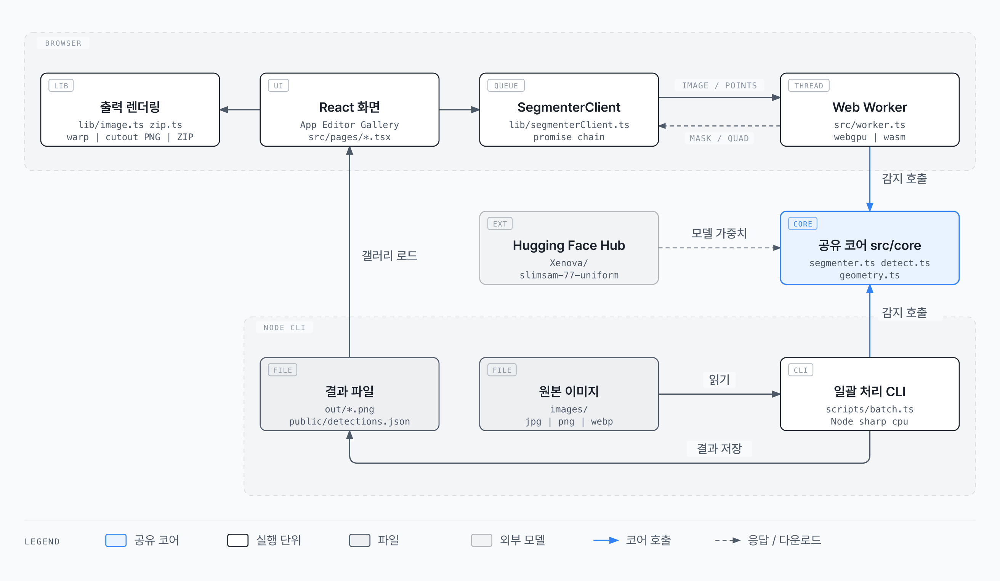

# 카드 자동 크롭 (card-auto-crop)

사진 속 카드(포토카드, 트레이딩 카드, 명함 등)를 찾아 반듯한 직사각형 이미지로 잘라주는 도구입니다. 세그멘테이션 모델 [SlimSAM](https://huggingface.co/Xenova/slimsam-77-uniform)(`Xenova/slimsam-77-uniform`)으로 카드 영역 마스크를 만들고, 마스크에 사각형을 맞춘 뒤 원근 보정(perspective warp)으로 펴냅니다.

브라우저 앱과 CLI 배치 스크립트 두 가지로 쓸 수 있고, 둘 다 같은 코어 코드(`src/core`)를 씁니다. 브라우저 앱은 모델 추론을 브라우저 안(WebGPU, 없으면 WASM)에서 돌리므로 이미지가 서버로 나가지 않습니다.

## 주요 기능

- 사진을 올리면 카드 하나를 자동으로 찾아 네 꼭짓점을 잡음 (여러 장 업로드 시 순서대로 처리)
- 클릭(포함) / `Alt`+클릭 또는 우클릭(제외)으로 영역 수정, 꼭짓점 드래그로 미세 조정
- 출력 방식 두 가지: `반듯하게 펴기`(원근 보정 직사각형) / `모양대로 오리기`(마스크 모양대로, 나머지는 투명)
- 원본 해상도로 다시 잘라 PNG 한 장 또는 `cards.zip` 으로 저장
- 예시 갤러리: `images/` 샘플의 자동 탐지 결과를 격자로 확인
- CLI: 폴더 전체를 일괄 크롭하고 감지 결과를 JSON으로 저장

## 요구 사항

- Node.js `^20.19.0` 또는 `>=22.12.0` (Vite 8 기준)
- pnpm (`packageManager: pnpm@11.8.0`)
- 처음 실행할 때 Hugging Face Hub에서 모델을 받기 위한 인터넷 연결 (브라우저는 이후 캐시 사용)

## 설치와 실행

```bash
pnpm install
pnpm dev        # Vite 개발 서버 (기본 http://localhost:5173)
```

상단 오른쪽 상태 표시에 `모델 준비 완료 (GPU)` 또는 `(CPU)` 가 뜨면 사용할 수 있습니다.

| 명령 | 설명 |
| --- | --- |
| `pnpm dev` | 개발 서버 실행 |
| `pnpm build` | `tsc --noEmit` 타입 체크 후 `dist/` 로 빌드 |
| `pnpm preview` | 빌드 결과 미리보기 |
| `pnpm batch -- [입력폴더] [출력폴더] [옵션]` | 폴더 일괄 크롭 (`tsx scripts/batch.ts`) |
| `pnpm detect` | `images/` 를 감지만 하고 `public/detections.json` 에 저장 (갤러리용) |

## 사용법

### 브라우저 앱: 크롭하기 탭

1. 왼쪽 패널에 사진을 끌어다 놓거나, 눌러서 선택하거나, `Cmd/Ctrl+V` 로 붙여넣습니다.
2. 사진마다 자동 탐지가 돌고 배지가 `대기 중` / `찾는 중` / `완료` / `직접 지정 필요` 로 바뀝니다.
3. 가운데 캔버스에서 영역을 고칩니다.

   | 조작 | 동작 |
   | --- | --- |
   | 클릭 | 이 지점을 포함하는 영역 선택 |
   | `Alt`+클릭 / 우클릭 | 이 지점 제외 |
   | 꼭짓점 드래그 | 모서리 위치 미세 조정 |
   | `작게` / `중간` / `크게` | 클릭으로 나온 후보 마스크 중 선택 |
   | `점 지우기` | 찍은 점 초기화 |
   | `다시 찾기` | 자동 탐지 다시 실행 |

4. 오른쪽 패널에서 출력 방식을 고르고 `이 사진 저장`(`<원본이름>_crop.png`) 또는 `전체 ZIP으로 저장`(`cards.zip`)을 누릅니다.

탐지는 긴 변 1024px로 줄인 이미지에서 하고, 저장할 때는 원본 해상도로 다시 디코딩해 꼭짓점을 비율대로 늘려서 자릅니다.

### 브라우저 앱: 예시 갤러리 탭

`images/` 샘플 사진의 탐지 결과를 보여줍니다. 파란 테두리가 잘라낼 영역입니다.

- 먼저 `pnpm detect` 로 `public/detections.json` 을 만들어야 합니다. 없으면 안내 화면이 뜹니다.
- `확인 필요` 필터는 카드를 못 찾았거나 사각형도(rectangularity)가 0.96 미만인 사진만 모읍니다.
- `편집` 을 누르면 그 사진이 크롭하기 탭으로 넘어갑니다.
- 샘플 이미지(`*.webp`)와 `public/detections.json` 은 git 대상이 아니므로 `images/` 에 직접 사진을 넣어 씁니다. 갤러리는 개발 서버에서만 동작합니다.

### CLI 배치

```bash
pnpm batch -- images out                                          # images/ 를 잘라 out/*.png 로 저장
pnpm batch -- images out --debug                                  # out/debug/*.jpg 확인용 썸네일도 저장
pnpm batch -- images out --no-save --json=public/detections.json  # 자르지 않고 감지 결과만 JSON으로
```

| 인자 / 옵션 | 기본값 | 설명 |
| --- | --- | --- |
| 첫 번째 인자 | `images` | 입력 폴더. `.jpg` / `.jpeg` / `.png` / `.webp` 만 읽음 |
| 두 번째 인자 | `out` | 출력 폴더 |
| `--debug` | 꺼짐 | 마스크 밖을 어둡게, 사각형을 초록 선으로 그린 폭 400px 썸네일 저장 |
| `--no-save` | 꺼짐 | 크롭 PNG를 만들지 않음 |
| `--json=<경로>` | 없음 | 파일별 `quad` 와 `rectangularity` 를 JSON으로 저장 |

- `sharp` 로 읽고 EXIF 회전을 적용하며, 축소 없이 원본 해상도로 모델에 넣습니다.
- Node에서는 `cpu` 디바이스로 추론하므로 한 장에 수 초가 걸릴 수 있습니다.

JSON 형식 (`quad` 는 좌상, 우상, 우하, 좌하 순서이며 못 찾으면 `null`):

```json
{
  "dir": "images",
  "items": [
    {
      "file": "a.webp",
      "width": 1200,
      "height": 1200,
      "quad": [{ "x": 136, "y": 258.6 }, { "x": 1059.7, "y": 260.6 }, { "x": 1058.7, "y": 968.7 }, { "x": 138, "y": 964 }],
      "rectangularity": 1
    }
  ]
}
```

## 동작 방식



- 모델 추론과 탐지는 Web Worker(`src/worker.ts`)에서 돌고, 요청은 `src/lib/segmenterClient.ts` 가 한 번에 하나씩 줄 세워 처리합니다. 이미지 임베딩은 한 번만 계산하고, 점을 찍을 때는 디코더만 다시 돌립니다.
- 자동 탐지(`detectCard()`, `src/core/detect.ts`)는 이미지 20%~80% 구간의 4x4 격자 점으로 후보 마스크를 모으고, 마스크 정리(가장 큰 덩어리 + 구멍 채우기)와 사각형 피팅 후 사각형도 / 면적 / 이미지 테두리 접촉으로 점수를 매겨 하나를 고릅니다. 슬리브나 케이스 안의 더 작은 반듯한 사각형이 있으면 안쪽 카드로 좁힙니다.
- 원근 보정(호모그래피)과 ZIP 생성(무압축 STORE + CRC32)은 외부 라이브러리 없이 직접 구현돼 있습니다.

다이어그램: [아키텍처](docs/diagrams/architecture.html) / [탐지 파이프라인](docs/diagrams/detect-pipeline.html) / [에디터와 워커 시퀀스](docs/diagrams/editor-sequence.html) (각각 같은 이름의 PNG 있음)

## 디렉터리 구조

```
card-auto-crop/
├── index.html              # 앱 진입 HTML
├── vite.config.ts          # 워커 ES 모듈 포맷, transformers.js 사전 번들 제외
├── scripts/batch.ts        # CLI 일괄 처리
├── src/
│   ├── App.tsx             # 상단 바, 탭(크롭하기 / 예시 갤러리), 상태 표시
│   ├── worker.ts           # Web Worker: 모델 로딩, 탐지, 점 예측
│   ├── zip.ts              # ZIP(STORE) 생성기
│   ├── core/               # 브라우저와 Node가 공유하는 로직
│   │   ├── segmenter.ts    # SlimSAM 래퍼 (transformers.js)
│   │   ├── detect.ts       # 자동 탐지와 점수 계산
│   │   └── geometry.ts     # 마스크 정리, 사각형 피팅, 워프, 컷아웃
│   ├── lib/
│   │   ├── image.ts        # 디코딩, 출력 렌더링, PNG, 다운로드
│   │   └── segmenterClient.ts  # 워커 래퍼와 직렬화 큐
│   └── pages/
│       ├── Editor.tsx      # 업로드 목록, 캔버스 편집, 미리보기, 저장
│       └── Gallery.tsx     # detections.json 기반 결과 격자
├── docs/diagrams/          # 다이어그램 (HTML 원본 + PNG)
└── images/                 # 샘플 이미지 폴더 (내용은 git 제외)
```

## 튜닝 값

| 값 | 위치 | 기본값 | 효과 |
| --- | --- | --- | --- |
| `MODEL_ID` | `src/core/segmenter.ts` | `Xenova/slimsam-77-uniform` | 사용할 SAM 계열 모델 |
| `grid` | `detectCard()` 인자 | `4` | 프롬프트 격자 크기 (호출 수 = grid 제곱) |
| 최소 면적 비율 | `scoreMask()` | `0.04` | 이보다 작은 마스크는 버림 |
| 테두리 패널티 | `scoreMask()` | `0.6 / 0.2 / 0.02` | 사진 가장자리에 닿은 변 1 / 2 / 3개 이상일 때 감점 |
| `PROC_MAX` | `src/lib/image.ts` | `1024` | 브라우저 탐지용 축소 크기 |
| `CHECK_THRESHOLD` | `src/pages/Gallery.tsx` | `0.96` | 갤러리 `확인 필요` 기준 사각형도 |

## 한계

- 자동 탐지는 사진 한 장에서 카드 하나만 고릅니다. 여러 장이 찍혔다면 점을 찍어 하나씩 지정합니다.
- 탐지 격자가 20%~80% 구간에만 있어 구석의 작은 카드는 놓칠 수 있습니다.
- 배경과 카드 색이 비슷하면 마스크가 번질 수 있습니다. `Alt`+클릭으로 배경을 제외하세요.
